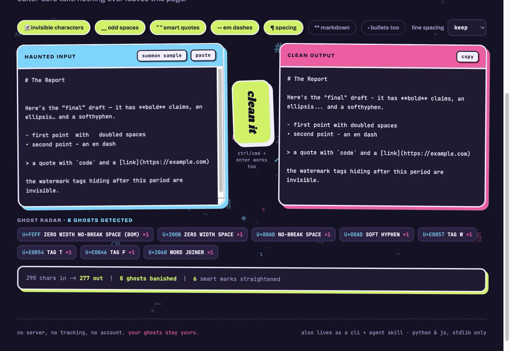

<h1 align="center">gptcleaner 👻</h1>

<p align="center">
  <b>Strip the ghosts out of AI text.</b><br>
  Zero-width spaces, hidden watermark characters, smart quotes, em dashes,
  spacing junk and markdown — gone, in one pass.
</p>

<p align="center">
  <a href="#install"></a>
  <a href="LICENSE"></a>
  <a href="#the-macos-app"></a>
  <a href=".github/workflows/ci.yml"></a>
</p>

<p align="center">
  
</p>

---

Paste something copied out of ChatGPT, Claude or Gemini into a CMS, a Word
document or a code editor, and it brings passengers: **characters you cannot
see**. Zero-width spaces wedged between words. A byte-order mark at the top. Tag
characters from the `U+E0000` block — the ones used to fingerprint AI output —
riding along invisibly after a full stop. Then the visible tells: curly quotes,
em dashes, doubled spaces, stray markdown.

gptcleaner removes all of it, and nothing else.

```console
$ gptcleaner report.txt --detect
Found 8 hidden/non-standard character(s) of 6 kind(s):

  CODE     NAME                                      COUNT  FIRST AT
  U+200B   ZERO WIDTH SPACE                              3  line 1, col 13
  U+FEFF   ZERO WIDTH NO-BREAK SPACE                     1  line 1, col 1
  U+00A0   NO-BREAK SPACE                                2  line 4, col 63
  U+E0057  TAG LATIN CAPITAL LETTER W                    1  line 9, col 44
```

## Install

**No dependencies anywhere.** Python 3.9+ for the CLI; the browser version and
the macOS app need nothing at all.

```bash
git clone https://github.com/nikhilakki/gptcleaner.git
cd gptcleaner
python3 gptcleaner.py --help          # that's it, it already runs
```

Optionally put it on your `PATH`:

```bash
./install.sh --bin                    # symlinks ~/.local/bin/gptcleaner
```

## Four ways to use it

| | What it is | Start it with |
|---|---|---|
| 🖥️ **CLI** | Pipe-friendly, scriptable, works on files, stdin or the clipboard | `python3 gptcleaner.py file.txt` |
| 🌐 **Web app** | Vanilla HTML/CSS/JS, ghost radar, runs fully offline | `python3 gptcleaner.py --serve` |
| 🍎 **macOS app** | Menu-bar clipboard cleaner with a global hotkey | `./macos/build.sh --run` |
| 🤖 **Agent Skill** | Teaches Claude Code, Codex, Cursor & co. to use it | `./install.sh` |

### The CLI

```bash
python3 gptcleaner.py notes.txt              # clean a file -> stdout
pbpaste | python3 gptcleaner.py              # stdin -> stdout
python3 gptcleaner.py -c                     # clean the clipboard in place
python3 gptcleaner.py notes.txt -i           # rewrite the file
python3 gptcleaner.py notes.txt --detect     # report only, change nothing
python3 gptcleaner.py notes.txt -m           # also strip markdown
python3 gptcleaner.py notes.txt --json       # machine-readable report
```

By default it removes invisible characters, converts exotic spaces to plain
ones, straightens smart punctuation, and tidies spacing. **Markdown stripping is
opt-in (`-m`)** because it is the destructive pass.

Presets for narrower jobs:

```bash
--preset zero-width    # invisible characters only, safe on source code
--preset watermark     # same, framed as watermark removal
--preset punctuation   # just the quotes and dashes
--preset spaces        # just whitespace
--preset markdown      # everything, including markdown
```

Full flag reference: [`skills/gptcleaner/reference.md`](skills/gptcleaner/reference.md).

### The macOS app

```bash
./macos/build.sh --install     # builds and drops it in /Applications
```

A universal (Apple Silicon + Intel) menu-bar app:

- **⌃⌥⌘C cleans the clipboard in place**, anywhere in the system. The menu bar
  icon flashes what it removed — no notification permissions needed.
- Per-pass toggles live in the menu bar, so you can leave dashes alone if you
  like them.
- **Open Cleaner Window** shows the full web UI in a native window.
- Optional "Hide Dock Icon" for a pure menu-bar utility.

Requires the Xcode command line tools (`xcode-select --install`) to build. The
app is ad-hoc signed, so the first launch may need right-click → Open.

### The web app

[`skills/gptcleaner/web/`](skills/gptcleaner/web/) is plain HTML, CSS and JS —
no build step, no framework. A three.js field of typographic ghosts drifts
behind the UI and scatters when you clean. It is a static folder, so it deploys
anywhere (Vercel, Pages, S3, a USB stick).

**Nothing is uploaded.** There is no backend at all: the page cleans text with
its own JavaScript. The only network requests are the three.js and font CDN
tags, and the tool works with both blocked.

### The Agent Skill

`gptcleaner` also ships as an [Agent Skill](skills/gptcleaner/SKILL.md), so
coding agents reach for it instead of improvising a regex:

```bash
./install.sh                    # every skill, every AI harness found on this machine
./install.sh --list             # show what would be targeted
./install.sh ~/skills/my-skill  # install a skill that lives outside this repo
./install.sh --uninstall        # remove it all cleanly
```

Harnesses that read `SKILL.md` get the skill directory; the rest get a small
pointer block spliced into the instruction file they already read
(`AGENTS.md`, `.cursor/rules/`, `GEMINI.md`, `.github/copilot-instructions.md`,
and others). Blocks are fenced with markers, so installs are idempotent and
uninstall restores files exactly.

## What counts as a ghost

Detection is by Unicode **category**, not a hand-maintained blocklist, so new
offenders are caught automatically:

| Removed | Examples |
|---|---|
| Control characters (`Cc`) | everything except tab, newline, carriage return |
| Format characters (`Cf`) | zero-width space/joiner/non-joiner, word joiner, BOM, soft hyphen, bidi marks and overrides |
| **Tag block** `U+E0000–E007F` | the vector for hidden text and AI watermarks |
| Variation selectors | `U+FE00–FE0F`, `U+E0100–E01EF` |
| Invisible letters | hangul fillers, khmer inherent vowels, braille blank |

| Normalised | To |
|---|---|
| Any `Zs` space (no-break, thin, ideographic…) | a plain space — *replaced*, never deleted, so words never fuse |
| `" " „ ‟ « »` | `"` |
| `' ' ‚ ‛ ′` | `'` |
| `— – ‒ ― −` | `-` |
| `…` | `...` |

**Deliberately kept**, because removing them would corrupt real text:

- `U+FE0F`, so emoji still render
- **Zero-width joiners inside emoji sequences** — `👩‍💻` is *woman + ZWJ +
  laptop*; dropping the joiner would split it into two glyphs. A ZWJ loose in
  prose is still removed.
- Format characters that carry meaning in Arabic, Syriac and Kaithi
  (`U+0600–0605`, `U+06DD`, `U+070F`, `U+08E2`, `U+110BD`, `U+110CD`)
- `snake_case`, `2 * 3`, and fenced code contents when markdown stripping is on

## Two engines, one behaviour

There are two implementations, because a browser cannot run Python and a CLI
should not need a browser:

| Engine | Powers |
|---|---|
| [`gptcleaner.py`](skills/gptcleaner/scripts/gptcleaner.py) | the CLI |
| [`cleaner.js`](skills/gptcleaner/web/cleaner.js) | the web app, and the macOS app via JavaScriptCore |

They are kept honest by a shared fixture file: both test suites read
[`tests/cases.json`](tests/cases.json), and a third runner diffs their output
character by character.

```bash
python3 tests/test_gptcleaner.py    # 55 tests, stdlib unittest
node    tests/test_cleaner.mjs      # 58 checks
python3 tests/test_parity.py        # both engines agree on 61 inputs
```

That harness has already earned its keep — it caught an empty character table
in the Python engine and a broken emoji sequence in both. See the
[changelog](CHANGELOG.md).

## Use it as a library

```python
from gptcleaner import clean, scan, Options

text, report = clean(raw, Options(markdown=True))
print(report["hidden_total"], report["removed"])

scan(raw)   # [(char, count, line, col), ...] - reports without changing anything
```

```js
const { clean, scan } = require("./skills/gptcleaner/web/cleaner.js");
const { text, report } = clean(raw, { markdown: true });
```

## Contributing

Bug reports and rules for characters I have missed are very welcome — see
[CONTRIBUTING.md](CONTRIBUTING.md). The short version: no dependencies, change
both engines, and never break real text.

## License

[MIT](LICENSE) © Nikhil Akki
